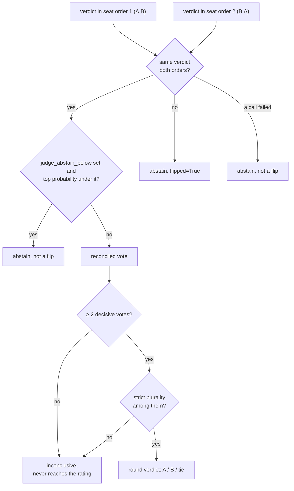

# Methodology

How orq-arena turns judged pairwise rounds into a ranking you can audit. This page is the
overview of the principles; the implementation itself is open source and is the full detail.

## How it works

For every round, one prompt, two candidates, in a round-robin tournament:

1. Both candidates answer the same prompt through the same orq.ai router gateway.
2. An evaluatorq jury compares the two responses. Every judge sees the pair twice, once in
   each seat order; a judge that contradicts itself between orders abstains rather than being
   trusted on a coin flip.
3. If fewer than two judges cast a decisive vote, the round is inconclusive and never reaches
   the rating.
4. Every judged round (win, loss, or tie) feeds a Bradley-Terry fit over all rounds so far.
5. The fit produces one rating per candidate with a bootstrap 95% confidence interval, plus,
   when the jury's length preference is statistically identified, a length-controlled rating
   that prices that preference out.
6. The run also reports how much the judges agreed with each other and how often each one
   flipped between seat orders, public evidence of how much to trust the verdicts.

## Judging

**Both seat orders, by default.** LLM judges measurably favor whichever answer they see first
(Zheng et al., 2023), so every judge scores each pair twice with the sides swapped:

`judge_swap: false` sends one order only: half the judge calls, no flip rule, and position
bias goes unmeasured. A judge that gives a different verdict in each order abstains for that round, and the flip is
recorded. A round needs at least two decisive votes (configurable) to produce a verdict, and
that quorum is necessary but not sufficient: the surviving votes still have to reach a strict
plurality. Two decisive votes that disagree one-all produce no plurality, so the round is
dropped from the rating rather than decided by a jury that could not agree with itself.

`judge_abstain_below` (decision panels only, off by default) adds one more way to abstain: a
reconciled vote whose winning option has a lower probability than the floor is set aside, the
same as a flip, and the quorum and plurality are then counted without it.

**Self-preference.** LLM judges recognize and favor their own family's prose (Panickssery et
al., 2024). A judge that is also a contestant is excluded from its own matches, and the
preflight warns whenever a judge shares a provider family with any candidate. The clean setup
is a jury drawn entirely from families outside the pool.

All judges score the same free-text criteria for the whole run (configurable, and swappable
after the fact with `rejudge`).

**Two kinds of judge.** With `judge_api: llm` each judge is a chat model prompted for a
verdict and a written reason. With `judge_api: decisions` each judge is a decision model asked
one question through the orq.ai Decisions API: is A better, B better, or neither? It answers
with a probability for each option and no prose; the vote is the most likely option, and its
probability is the judge's confidence. Everything above holds for both: both seat orders, the
flip rule, the quorum and the plurality. A decision model bills input tokens only, which is
why a decision jury costs a fraction of a prompted one. How the two compare on real arena
rounds is in [LLM judges vs decision models](research/llm-judges-vs-decision-models.md).

## Ratings

**Bradley-Terry, not incremental Elo.** Ratings come from a maximum-likelihood Bradley-Terry
fit (Bradley & Terry, 1952) over every judged round, refit as the tournament progresses; ties
count as half a win for each side. This is the same statistical core as Chatbot Arena's
leaderboard (Chiang et al., 2024). Ratings are anchored so the field's average sits at 1000.

**Confidence intervals.** A 1000-resample bootstrap gives each candidate a 95% CI. On a small
run the intervals are wide and overlapping; that is the honest output. Those intervals are
*marginal*, so read one at a time: two of them overlapping does not mean the two models are
tied, or even that they are indistinguishable. Both are drawn from the same resamples and
share the anchoring, so they move together.

**Separation.** Whether the top two actually differ is a question about their *difference*,
bootstrapped within each resample: the top spot is separated when that difference interval
excludes 0. When it does not, the run reports the measured gap and how often the leader came
out ahead ("ahead in 71% of resamples") rather than declaring a tie, which the data cannot
support either way.

**Length control.** Seat-swapping fixes position bias, not verbosity bias: a jury that likes
longer answers likes them in both orders. The headline claim is deliberately a plain count,
how often the longer answer (in characters) won a decisive round, because a count has no
estimator behind it and nothing to converge. Behind it, following length-controlled
AlpacaEval (Dubois et al., 2024) and LMArena's style control, the fit is repeated with a
length term: a joint logistic fit (Newton with a line search, stopped on the gradient norm,
never on an iteration budget) yields the jury's length coefficient, and a second rating
column reports each model with that preference priced out (`length-adj.` on the report page,
`len-ctrl` in the live TUI). The coefficient and the column appear only when the preference
is identified: the fit converged and a bootstrap interval over the same rows excludes 0.
Resamples where one side always wins have no finite coefficient; they are counted as
separated and widen the interval rather than being dropped. A big gap between a model's two
ratings means verbosity, not quality, is doing the separating. Length is the only style axis
controlled today; markdown formatting is not.

**Per-category slices.** Ratings are also refit per prompt category, but only for categories
with enough comparisons to mean anything; thin slices are dropped instead of shown with
misleading precision.

**Fixed settings.** These are constants, not config keys: 1000 bootstrap resamples for the
rating intervals and 400 for the length coefficient, a category slice needs 20 judged
comparisons, a model enters a rater's human-anchor ranking with at least 3 qualifying rounds,
and the run's schedule, prompt draws and resamples use seed 42.

## Auditing the jury

Every run reports the numbers needed to challenge its own ranking:

- **Agreement**: mean modal-vote share per round, plus chance-corrected Fleiss' and Cohen's
  kappa with the standard Landis-Koch labels (poor to almost perfect). Fleiss' kappa counts only
  the rounds where every primary judge cast a decisive vote, and the report says how many that
  was; Cohen's kappa uses each pair's rounds where both were decisive. Votes from stand-in
  judges are left out of both.
- **Per-judge flip rates**: how often each judge contradicted itself between seat orders,
  published per judge rather than hidden in an average.
- **Jury swap**: `rejudge` re-scores the recorded responses under a different panel (judge
  tokens only, zero regeneration) and reports the Spearman rank correlation against the
  original ranking, the direct test that the ranking is not an artifact of which judges were
  picked.

## Reliability

- **Failed streams void the round.** One retry per side; a second failure voids the round,
  which is logged and shown but never judged or rated. The rating reflects the candidates'
  words, never the network's mood.
- **Timeouts measure silence, not duration.** A stream only dies after a long gap with no new
  chunk, so a model that thinks for minutes before its first token is not penalized.
- **Truncation is judged, not hidden.** A response cut off by its token cap is judged as-is
  and flagged visibly; the jury sees exactly what a reader would see.
- **A voided round keeps what it received.** The partial response is recorded alongside the
  error rather than discarded. The round is still never judged and never rated; the text is
  there so a failure can be diagnosed from the log instead of guessed at.

## Reproducibility

Every run is seeded (schedule and prompt draws) and writes a manifest next to the battle log
with the config it ran, content hashes of that config and the prompt set, the prompts path, the
host the run actually reached, the judge panel, and the closing agreement stats, so two runs are
provably comparable and any rating can be re-derived from its log. The prompt hash covers each
prompt's category as well as its text, so two banks that differ only in how they label prompts are
not mistaken for the same set.

Rounds are written to the battle log as they resolve, not batched to the end of a match, so a run
interrupted partway keeps every round it already paid for. Each record carries the full router id
of both models alongside the short display name, because short names collide across providers
(`openai/gpt-oss-120b` and `groq/gpt-oss-120b`). Every view the run and its report produce is keyed
on that full id, not just the leaderboard: the rating, the length-controlled rating, verbosity, cost
and speed, so two providers of one model can never be apart in one panel and merged in another.
When two candidates would share a display name, both fall back to their full ids and the preflight
says so.

`orq-arena report <log>` rebuilds from that manifest, not from the live YAML: model names, the
judge panel and the reasoning flags come from the run itself, so regenerating a page after the
config moved on cannot relabel a model or compute &kappa; against a panel that never judged the
run. Runs recorded before the full config was stored still pin all three from the manifest's
candidate and judge entries. When identity has to come from a config file instead (no readable
manifest, or an explicit `--config` that disagrees with the recorded `config_sha256`), the page
says so in its Confidence stats, so a forwarded report carries the caveat with it.

## Human anchor: does the panel agree with people?

The jury metrics above measure the panel against itself; the human-anchor workflow measures
it against people. `annotate` renders a recorded run into a blind annotation page (no model
names, no jury votes, sides swapped per round) you can send to raters; `anchor` merges their
votes back and reports each rater's kappa against the panel majority and the rank correlation
between the human ranking and the panel's. Both rankings behind that correlation are fit on
the rounds the rater actually voted: models below a minimum comparison count are left out
rather than seated at the default rating, and the model count prints beside every
correlation. Usage: [cli.md](cli.md#annotate).

## Lessons from The Leaderboard Illusion

In 2025 a study of Chatbot Arena, the best-known public LLM leaderboard, found that its rules
let a few big labs look better than they were (Singh et al., 2025). Arena disputed parts of
the account. The study closes with five fixes. orq-arena is a private arena you run yourself,
not a public leaderboard, but the same traps apply, so here is where each one stands:

| What the study found | What orq-arena does |
| --- | --- |
| Labs tested many versions in secret and hid the scores they did not like. | Every round is written to the battle log the moment it ends, including failed and inconclusive ones. The report covers the whole pool; there is no option to drop a model from it. |
| Some labs got far more secret tests than others. | Nobody submits models to your arena. You choose the pool. |
| Models were quietly removed, mostly open ones, which skews the ratings of the rest. | The pool is fixed for the whole run and every pair of models meets, so no comparison is missing. |
| Some models were shown to voters far more often. | Every pair is judged on the same number of prompts, in a seeded random order. |
| Outsiders could not see what was tested, removed, or how often. | The battle log, the run manifest and the report hold every answer, every judge vote and how much the judges agreed. |
| Labs trained on Arena data to climb the board. | You rank on your own prompts, which no lab has trained on. |

One trap no tool can close for you: running again (a new seed, or `rejudge` with another
panel) until you like the result, then sharing only that run. If you publish a ranking, publish
every run behind it. Two smaller notes: each pair is judged on its own random draw of prompts
when `max_rounds` is below the size of your prompt set (the preflight says so), and pairs are
not sampled adaptively, since a full round-robin already compares every pair equally.

## Current limitations

- **The shipped 30-prompt bank is a smoke test**, sized to exercise every mechanism, not to
  defend a ranking. A ranking you intend to defend takes your own prompt set (hundreds of
  rounds) and judges from families outside the pool.

## References

- Bradley & Terry (1952). Rank Analysis of Incomplete Block Designs: The Method of Paired
  Comparisons. [doi:10.2307/2334029](https://doi.org/10.2307/2334029)
- Zheng et al. (2023). Judging LLM-as-a-Judge with MT-Bench and Chatbot Arena.
  [arXiv:2306.05685](https://arxiv.org/abs/2306.05685)
- Chiang et al. (2024). Chatbot Arena: An Open Platform for Evaluating LLMs by Human
  Preference. [arXiv:2403.04132](https://arxiv.org/abs/2403.04132)
- Dubois et al. (2024). Length-Controlled AlpacaEval: A Simple Way to Debias Automatic
  Evaluators. [arXiv:2404.04475](https://arxiv.org/abs/2404.04475)
- Panickssery et al. (2024). LLM Evaluators Recognize and Favor Their Own Generations.
  [arXiv:2404.13076](https://arxiv.org/abs/2404.13076)
- Singh et al. (2025). The Leaderboard Illusion.
  [arXiv:2504.20879](https://arxiv.org/abs/2504.20879)
